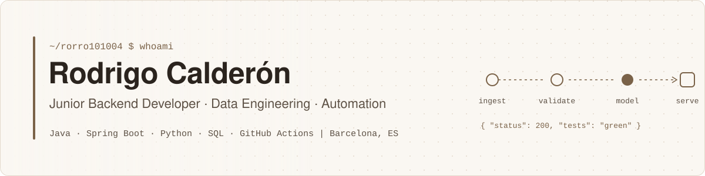
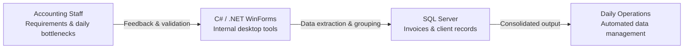
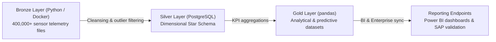
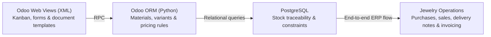
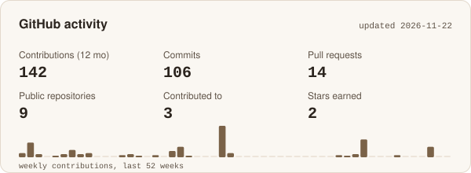
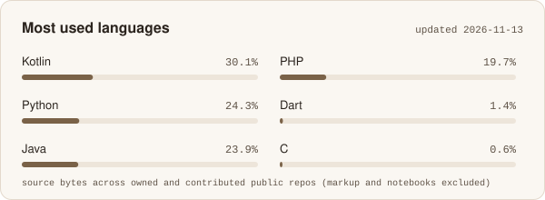

  <b>English</b> · <a href="./README.es.md">Español</a>

<picture>
  <source media="(prefers-color-scheme: dark)" srcset="assets/banner-dark.svg">
  <source media="(prefers-color-scheme: light)" srcset="assets/banner-light.svg">
  
</picture>

  <a href="#focus">Focus</a> ·
  <a href="#stack">Stack</a> ·
  <a href="#featured-projects">Projects</a> ·
  <a href="#experience">Experience</a> ·
  <a href="#metrics">Metrics</a> ·
  <a href="#contact">Contact</a>

Junior software developer (Higher Technician in **Multiplatform Application Development, DAM**) based in **Barcelona**. I build backend services, data pipelines and automation that replace manual work with tested, maintainable code.

## Focus

- **Backend:** REST APIs with Java and Spring Boot, relational modelling, transactional integrity.
- **Data engineering:** Python pipelines for ingestion, validation and analysis (pandas, SQL).
- **Automation and quality:** CI with GitHub Actions, test-first refactoring, AI-assisted tooling with human approval gates.
- **Looking for:** Junior Backend / Data Engineering roles (on-site, hybrid or remote). Comfortable working fully in English in international agile teams.

## Stack

Every item below is traceable to code in a public repository.

| Area | Technologies |
| :--- | :--- |
| **Languages** |       |
| **Backend** |     |
| **Data** |     |
| **Databases** |    |
| **Mobile** |   |
| **Quality and DevOps** |       |

## Featured projects

| Project | What it does | Stack | Role |
| :--- | :--- | :--- | :--- |
| [**ZeroBreak**](https://github.com/Rorro101004/ZeroBreak) | Spec-driven framework and CLI to refactor Python without breaking contracts: pytest baseline, SHA-256 integrity guards, didactic backup, guarded apply with automatic rollback, golden-master and Hypothesis test scaffolding. CI on Ubuntu and Windows, 100 % coverage. | Python 3.12, pytest, Hypothesis, ruff, mypy, GitHub Actions | Author |
| **EasyTeeth** · [API](https://github.com/JoanMarcMM/EasyTeeth_BackEnd) · [Android](https://github.com/JoanMarcMM/EasyTeeth_FrontEnd) | Dental clinic management: appointment slots, clinical boxes and patient records. REST API with OpenAPI docs and an Android client. 9-month project, team of 4. | Spring Boot 4, JPA, MySQL, Kotlin, Compose, Retrofit | Android networking layer, API endpoints |
| [**Hospital API**](https://github.com/JoanMarcMM/Hospital_Project) | REST API for nurse management: CRUD, search and authentication, with controller tests, Postman collection and CI. Team of 4. | Spring Boot, Maven, JUnit, Postman, GitHub Actions | Backend developer |
| [**People MVC (Foxtrot)**](https://github.com/Joan735/Foxtrot) | Multi-storage CRUD application built around a strict MVC contract with pluggable persistence (SQL, ObjectDB, file streams), JUnit 5 test suite and Maven CI. | Java 17, MySQL, ObjectDB, JUnit 5, GitHub Actions | Co-author (37 commits) |
| [**Data access layer**](https://github.com/Rorro101004/RA1AccesoAdatos) | Shop management system that swaps persistence back-ends behind a DAO interface: JDBC, Hibernate, MongoDB and ObjectDB. | Java 17, JDBC, Hibernate, MongoDB, Maven | Author |
| **Data notebooks** · [EDA](https://github.com/Rorro101004/RA3-DataSets) · [ETL test](https://github.com/Rorro101004/PruebaTecnica) | Video-game sales exploratory analysis (feature engineering, regional splits, outliers) and a data-engineering exercise: normalization, validation, dedup hashes and SQLite loading with assertions. | pandas, NumPy, seaborn, sqlite3 | Author |
| [**NexTech**](https://github.com/Rorro101004/Nextech) | Tech-event platform with user registration, login and event CRUD on a PHP MVC structure. Team of 3. | PHP, MVC, CSS | Project manager, backend |

## Experience

<b>Software Developer Intern — BittaSoftware</b> · <code>C# · .NET WinForms · SQL Server</code>

 

- **Context & Team:** Developed internal tooling at an accounting firm within a 2-person development team (my manager/senior developer and myself), collaborating in a private company repository.
- **Requirements Gathering with End Users:** Worked directly with internal colleagues (accountants and staff) to identify repetitive daily tasks—such as manually collecting scattered data across invoices and clients—and documented tool requirements to streamline their workflow.
- **Iterative Desktop Development:** Designed and implemented internal desktop applications in **C# (.NET / WinForms)** connected to **SQL Server** to automate the extraction, grouping, and management of invoice and client records.
- **Continuous Feedback Loop:** Maintained ongoing collaboration with both end users (validating usability in real workflows) and my senior lead (reviewing technical implementation and shipping iterative improvements).

<b>International Data Engineering Project — Timișoara, Romania</b> · <code>Python · Docker · PostgreSQL</code>

 

- **Medallion Data Architecture:** Co-architected a containerized **Bronze / Silver / Gold** pipeline using **Python** and **Docker** to ingest, parse, and normalize **400,000+ raw sensor telemetry files**.
- **Dimensional Modeling (Star Schema):** Transformed high-volume telemetry streams into a normalized **star schema in PostgreSQL** (fact and dimension tables), resolving missing dimensions, schema drift, and sensor outliers.
- **Analytics & Cross-Border Delivery:** Built Gold-layer aggregations with **pandas** feeding **Power BI** dashboards and **SAP** validation workflows, operating **100 % in English** within a distributed international agile team (Romania, Switzerland, Portugal, Spain).
- **Operational Impact:** Cut end-to-end dataset preparation from hours of manual processing per sprint to reproducible containerized runs completing in **under 2 minutes**.

<b>Jewelry Retail ERP Customization — Odoo (STUCOM)</b> · <code>Odoo ERP · Python · PostgreSQL</code>

 

- **Industry-Specific ERP Solution:** Designed and implemented a custom **Odoo ERP** vertical for a **jewelry retail & manufacturing business** within a 3-developer engineering team.
- **End-to-End Module Customization:** Extended core **Python (Odoo ORM)** models and XML views across **purchasing, sales orders, raw material & precious metal tracking, multi-attribute product variants, delivery notes (*albaranes*), and automated invoicing**.
- **Relational Integrity:** Enforced stock traceability, computed valuation fields, and transactional constraints backed by **PostgreSQL**.

## Metrics

  <picture>
    <source media="(prefers-color-scheme: dark)" srcset="assets/metrics/stats-dark.svg">
    <source media="(prefers-color-scheme: light)" srcset="assets/metrics/stats-light.svg">
    
  </picture>
  <picture>
    <source media="(prefers-color-scheme: dark)" srcset="assets/metrics/languages-dark.svg">
    <source media="(prefers-color-scheme: light)" srcset="assets/metrics/languages-light.svg">
    
  </picture>

Generated daily by a GitHub Actions workflow in this repository. No third-party stats services.

## Contact

Open to **Junior Backend Developer**, **Data Engineering** and **ERP / automation** roles.

